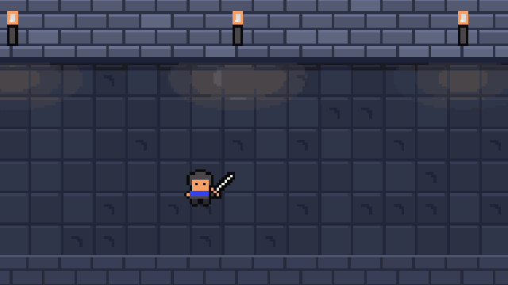

# Playtest Lens



**A dashcam for game testers.** Plug in an Android phone and play. Playtest Lens keeps the last 30 seconds of screen, touches and logs, catches crashes and "app not responding" on its own, and lets you mark anything else with one key. Every bug becomes a folder with a clip, the logs, your touches and a report you can paste into Jira or GitHub. Everything runs on your computer, free.

> Status: phases 1–4 of 6 built (recording, the detectors, reports, the dashboard, health, seen-again and build checks). Full video with sound: [docs/ident/lens-ident-40s-phone.mp4](docs/ident/lens-ident-40s-phone.mp4). See [PLAN.md](PLAN.md).

## Try it

You need Python 3.10+, `adb` (Android platform-tools) and `ffmpeg`, and a phone with **USB debugging** on.

```sh
git clone https://github.com/<you>/playtest-lens && cd playtest-lens
python3 -m venv .venv && .venv/bin/pip install -e .
ln -s "$PWD/.venv/bin/lens" ~/.local/bin/lens     # optional: run `lens` from anywhere
lens com.example.game                            # first time: the game's package
lens                                             # after that: the same game again
```

**On Windows** (10 or 11), in PowerShell:

```powershell
winget install Python.Python.3.12 Google.PlatformTools Gyan.FFmpeg    # then open a new terminal
git clone https://github.com/<you>/playtest-lens; cd playtest-lens
py -m venv .venv; .venv\Scripts\pip install -e .
.venv\Scripts\lens com.example.game
```

Everything works the same, including the dashboard and Discord. Text on the phone's screen (button names, the scoreboard, text bugs) is read with Windows' own built-in OCR instead of macOS Vision, so it needs no setup; if your Windows has no OCR language installed, add English under Settings → Time & language → Language. "Copy text" shows the clip in File Explorer.

- A crash or ANR is saved automatically, and so is a real freeze (you keep tapping, nothing on screen changes for 3 s and the game stops drawing frames), frame drops (the game stutters under 30 fps), text bugs (raw keys like `MENU_START_TITLE`, `{0}`, `null` on screen) and missing-texture magenta. Clips have an FPS meter in the corner. Wrong catch? Type `x` and Enter.
- **Dashboard:** open http://127.0.0.1:8737 while Lens runs: the phone's screen, the bug feed, clips with your taps on the timeline, reports you can edit, Copy for Discord and a prefilled GitHub issue. `lens ui` opens it on saved bugs without a phone. It only listens on your own computer.
- Saw something the detectors missed? Press **Enter** in the terminal (or **F8**, or Mark in the dashboard): the moment is saved right away, the 15-second clip starting 12 seconds *before*. Then type what went wrong whenever you're ready and press Enter; it goes into that bug's report.
- **Discord:** Lens never posts anything; you paste. Copy for Discord (D) shows your explanation as the message (tick *Add details* for the scoreboard, buttons pressed and device); Copy text puts it on the clipboard and shows the clip in Finder (File Explorer on Windows) to drag in. Copy clip (V) puts the clip itself on the clipboard for ⌘V. Clips over Discord's 20 MB are re-encoded to `discord.mp4` first. Works in channels, group DMs and DMs.

Each bug lands in `bugs/<time>_<kind>/`: `clip.mp4` (15 s, with your taps shown), `moment.jpg` (the screen at the bug), `report.md`, `logcat.txt`, `touches.jsonl`, `meta.json`.

## Develop

```sh
.venv/bin/pip install -e ".[dev]" && .venv/bin/pytest
```

The tests use recorded crash dumps and touch streams, so no phone is needed.

## License

MIT
